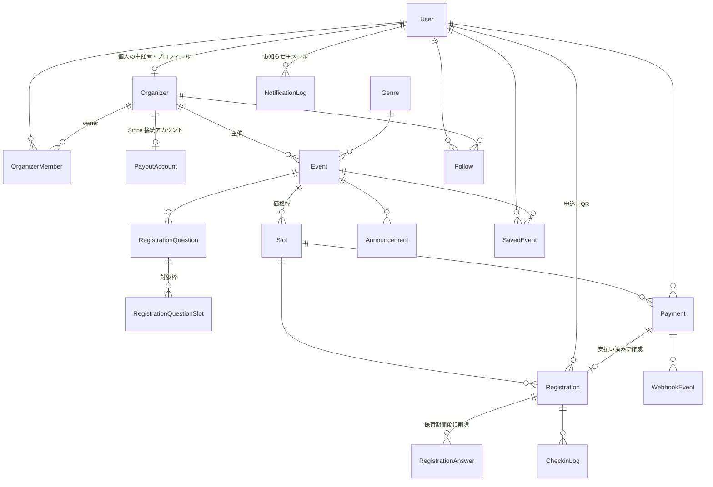
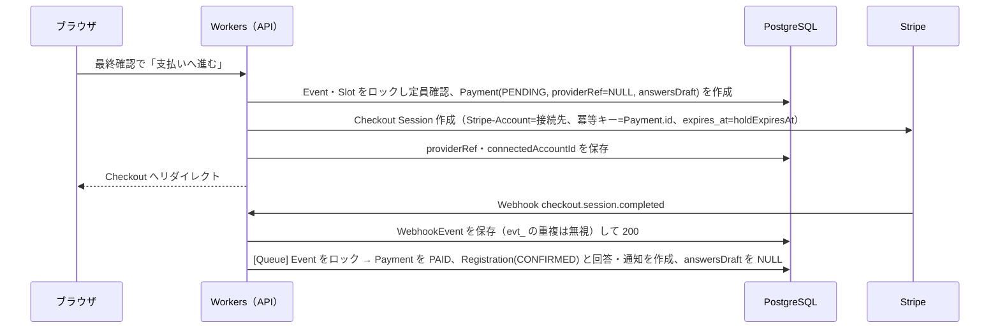
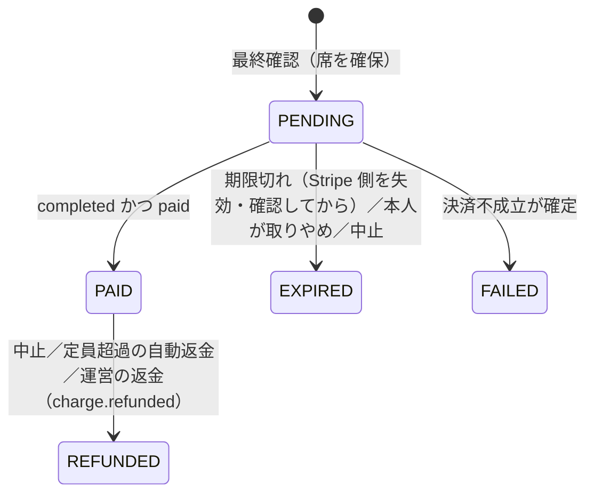

# NMJ チケット DB 設計 v0.5

[schema.prisma](schema.prisma) を v0.4（10/8 定例）から v0.5 に更新した。この文書は変更の理由、公開範囲、申込と決済の流れ、未決事項をまとめる。実装・マイグレーションの適用はまだ。

## 参照した資料

| 資料 | 使ったところ |
| --- | --- |
| [打ち合わせメモ](backend-planning.md) 10/22 | 1アカウント・1イベント・1枚・価格枠1つ（確定）、公開範囲の方針、1イベント1枠に合わせる DB 変更案、セキュリティ方針 |
| [実装計画](implementation-plan.md) | PostgreSQL＋Hyperdrive、Queues・Cron、Webhook 受信記録と Outbox |
| [制作スケジュール](schedule.html) | Stripe Checkout＋Connect Standard、返金は運営が Stripe 管理画面で対応、12/24 疑似決済・1/28 実決済 |
| チケットプロトタイプ `docs/ticket/`（main、11/12） | 画面で使う列・操作（申込、決済、受付、告知、移管、通報、CSV） |
| [ER図](er-diagram.html)・[ワイヤーフレーム v0.4](wireframes.html) | 10/8 の決定（補欠なし、枠の種類、保存、権限） |

## v0.4 からの主な変更

| 変更 | 理由 |
| --- | --- |
| `Ticket` を `Registration` に統合。申込1行が QR チケット1枚になり、`qrToken`・受付状態・`priceYen` を持つ | 1イベント1枠になり、申込とチケットが常に1対1になったため。表が減り、キャンセル後の再申込は新しい行・新しい QR になる |
| `Registration` に `eventId` を追加し、`(eventId, userId)` の CONFIRMED を部分一意に | 別の枠への重複申込を DB で防ぐ（v0.4 は枠ごとの一意だけ） |
| 枠の参照を `(slotId, eventId)` の複合外部キーに（`Slot` に `@@unique([id, eventId])`） | 別イベントの枠を指す申込・決済を DB で拒否する |
| `Payment.slotIds[]` → `slotId`。`providerRef` を NULL 可に。`paymentIntentId`・`connectedAccountId`・`applicationFeeYen`・`currency`・`expiredAt`・`refundReason` を追加 | 先に DB で席を確保してから Checkout を作る順序にするため。Connect Standard の direct charge では返金先の接続アカウントを決済ごとに残す必要があるため |
| `WebhookEvent` を追加 | 署名検証後に保存して即応答し、処理は Queue で行う。同じイベント ID の再送は主キーで弾く |
| `NotificationLog` に `dedupeKey`・`attempts`・`nextAttemptAt` を追加（Outbox） | Webhook の再送で通知が二重にならないようにし、送信失敗を Cron で拾い直す |
| `PayoutAccount` を主催者ごとに1つにし、Stripe の状態（`chargesEnabled` など）を持たせる。`Event.payoutAccountId` は削除 | 有料枠の公開・決済開始の可否を判定するため。決済時点の入金先は `Payment.connectedAccountId` に残す |
| `RegistrationQuestion.slotIds[]` → 中間表 `RegistrationQuestionSlot` | 対象枠を外部キーで守る |
| `Report.targetId` → `eventId` / `organizerId`（どちらか一方を CHECK） | 外部キーを張れるようにする |
| `AuditLog`・`OperationSwitch` を追加 | 監査ログと、新規申込・決済開始・CSV 出力の緊急停止 |
| Auth.js の3表 → `Session`（トークンのハッシュ）と `User.googleSub` | 認証ライブラリは未定。Google ログイン＋サーバー側セッションに必要な最小限にした |
| `Invitation.token` → `tokenHash` | 招待リンクの生トークンを DB に置かない |
| `User.deletedAt`・`Organizer.deletedAt` を追加 | 退会しても決済・申込の記録を残す |
| `Event.answersPurgedAt`、`AnswerExportLog.rowCount` を追加 | 回答削除の済み印（Cron を何度実行しても同じ結果）と、出力件数の記録 |
| `Genre.nameEn`・`color` を追加 | プロトタイプのジャンルカードが使っている |
| `University`・`Event.targetUniversityId`・`AnswerExportLog.includeWaitlist` を削除 | 10/8 で大学の絞り込みと補欠をなくしたため |

## 全体像

Media（`MediaArticle` ほか）、通報、監査ログ、停止スイッチは図から省いた。

## 公開範囲

API は返す列を許可リストで決める。全列を返して一部を除く実装はしない。

| データ | 未ログインでも公開 | 本人 | 主催者（owner） | NMJ 運営 |
| --- | --- | --- | --- | --- |
| `Organizer`（あだ名、@ユーザーネーム、アイコン、自己紹介、SNS） | ○ | ○ | ○ | ○ |
| `Event`・`Slot`（`onlineUrl` を除く）、残席の数 | ○（公開中のみ） | ○ | ○ | ○ |
| `Event.onlineUrl` | × | 参加予定のときのみ | ○ | ○ |
| 参加者のあだ名 | `PUBLIC_NICKNAME` のイベントのみ | ○ | ○ | ○ |
| `RegistrationAnswer`（本名、フリガナ、所属、自由回答） | × | ○ | 自団体のイベントのみ・保持期間内 | 対応時のみ |
| `User.email`・`badgeName` | × | ○ | × | ○ |
| `Registration.qrToken` | × | ○（QR 表示） | ×（読み取りで照合するだけ） | × |
| `Payment`（金額・状態） | × | ○ | 自団体のイベントの集計 | ○ |
| `PayoutAccount` の状態 | × | − | ○ | ○ |
| `Report`・`AuditLog`・`WebhookEvent` | × | 自分の通報の状態 | × | ○ |

保留中の項目がある。本名・所属・参加履歴の公開範囲は、10/22 の「基本は公開、電話・メールは非公開」の方針の下で項目ごとに決める（[未決事項](#未決事項)の1）。v0.5 は「回答は公開しない」側で作った。公開すると決まったら、公開用の列を `Organizer` に足す。回答をそのまま公開する方法はとらない。

## 申込と決済の流れ

### 無料枠

1トランザクションで処理する。順序は「`Event` を `FOR UPDATE` → `Slot` を `FOR UPDATE` → 定員の確認 → `Registration`（CONFIRMED）と回答を作成 → `NotificationLog`（QUEUED）を作成」。

### 有料枠

`Payment` の状態は次のように変わる。

- Checkout の作成で通信が失敗し結果が分からないときは、同じ冪等キーで作り直す。それでも分からなければ `providerRef` が NULL の PENDING として残し、照合用の Cron が Stripe を検索して決める。
- 期限切れの扱いは v0.4 と同じ。先に `checkout.sessions.expire` を呼び、失敗したら Session を取得する。支払い済みなら PAID、未払いなら EXPIRED にする。時刻を過ぎたというだけで席を再販売しない。
- 席を解放した後に支払いが確定し、定員を超えてしまった場合は自動で返金し（`refundReason=OVER_CAPACITY`）、本人に `PAYMENT_REFUNDED` を送る。
- 本人がキャンセルした場合は返金しない（プロトタイプの表示どおり）。`Registration.cancelReason=USER` で、`Payment` は PAID のまま残る。
- 中止したイベントは全件を返金する。`Registration` は CANCELLED（`EVENT_CANCELLED`）、`Payment` は REFUNDED（`EVENT_CANCELLED`）にする。

### 定員の数え方

ロックは常に `Event` → `Slot` の順で取る（無料申込、決済開始、Webhook での確定に共通）。数える対象は、CONFIRMED の `Registration` と PENDING の `Payment` の合計。

- 枠の残り = `Slot.capacity` − その枠の合計
- イベント全体の残り = `Event.capacity` − イベント全体の合計（`capacity` が NULL なら枠の残りだけで判定）

「本編のみ」と「本編＋懇親会」の2枠で本編の定員を共有したいときは、全体の定員を `Event.capacity` に、懇親会の人数を「本編＋懇親会」枠の `capacity` に入れる。

## 保持期間と削除

| データ | 期限 | 処理 |
| --- | --- | --- |
| `RegistrationAnswer` | `endAt` ＋ `answerRetentionDays`（30／90／365） | Cron で削除し `Event.answersPurgedAt` を記録。7日前に主催者へ予告（`dedupeKey=ANSWER_DELETION_NOTICE:<eventId>`） |
| `Payment.answersDraft` | PAID・EXPIRED・FAILED になった時点 | NULL にする。残っていても上の Cron で消す |
| `Session` | `expiresAt` | Cron で削除 |
| `WebhookEvent.payload`・`AuditLog.ipHash` | 未決（案：90日） | Cron で削除・NULL 化 |
| `User`（退会） | 退会時 | `deletedAt` を入れ、email・googleSub を匿名値に置き換え。`Organizer`（個人）を非公開にし、セッションを失効。決済・申込の行は残す |

## 検証したこと

検証はローカルの PostgreSQL（Homebrew）で一時的に行った。

- `prisma validate` と `prisma format` を通した（Prisma 6.16）。
- `prisma migrate diff` で生成した SQL と、末尾の手書き SQL を空の DB に適用できた。
- 次の操作は制約で拒否された。
  - 同じ人が同じイベントで2つ目の有効な申込をする（別の枠でも）
  - 別のイベントの枠を指す
  - 有料なのに決済が付いていない申込
  - 理由のないキャンセル
  - 同じ人・同じイベントで2つ目の PENDING
  - providerRef のない PAID
  - 手数料が金額以上
  - 対象が食い違う通報
  - 同じ Webhook イベントの二重保存
- キャンセル後の再申込は通った。
- 枠の定員2と5、全体上限3のイベントに30人が同時に申し込んだ（無料と有料が半々）。上記のロック順序で処理した結果、確定と確保の合計は3件で、残りの27件は満員として返った。

## ほかの資料に必要な直し

- チケットプロトタイプ（`docs/ticket/apply.html`、`data.js`）は複数の枠を選べる（チェックボックス）。これを1つだけ選ぶ形（ラジオボタン）にし、`data.js` を v0.5 の表に合わせる。担当はデザイン・プロトタイプ側と相談する。
- [ER図](er-diagram.html) は v0.4 のまま。この文書の内容で更新する。
- [打ち合わせメモ](backend-planning.md) の「1イベント1枠に合わせるDB変更案」は v0.5 に反映済み。

## 未決事項

決まったときに変える場所も併記する。

| # | 決めること | v0.5 の仮置き | 決まったら変える場所 |
| --- | --- | --- | --- |
| 1 | 本名・所属・参加履歴の公開範囲 | 回答は公開しない。参加者のあだ名だけ `attendeeListVisibility` で公開 | `Organizer` に公開用の列、`User` に公開設定 |
| 2 | 運営手数料率（11/26 締切） | 決済ごとに `applicationFeeYen` を金額で保存 | 率の保存場所（設定表 or 環境変数） |
| 3 | 個人主催者（`type=USER`）も有料イベントを出せるか | 出せる（`PayoutAccount` は主催者ごと） | 出せないならアプリで制限 |
| 4 | 席の確保時間 | 30分（Stripe Checkout の最短） | `holdExpiresAt` の計算 |
| 5 | キャンセル後の再購入 | 許可（CONFIRMED のみ一意） | 禁止なら部分一意の条件を変える |
| 6 | 懇親会だけの購入、本編と懇親会の別定員 | 「本編＋懇親会」の枠と `Event.capacity` で表せる範囲に限る | 懇親会だけの在庫が必要なら在庫の表を追加 |
| 7 | 通報への対応（イベント非公開・団体の統合・削除） | 状態とメモだけ | `Event`・`Organizer` に運営による非公開の状態 |
| 8 | 認証ライブラリ | `Session` を自前で持つ | ライブラリの必須の表に合わせる |
| 9 | Wallet、記事の投稿と審査を初回に含めるか | 表は残す | 外すなら初回のマイグレーションから除く |
| 10 | HP のお問い合わせフォーム | この DB では扱わない（HP 側のフォームサービス） | 保存が必要なら表を追加 |
