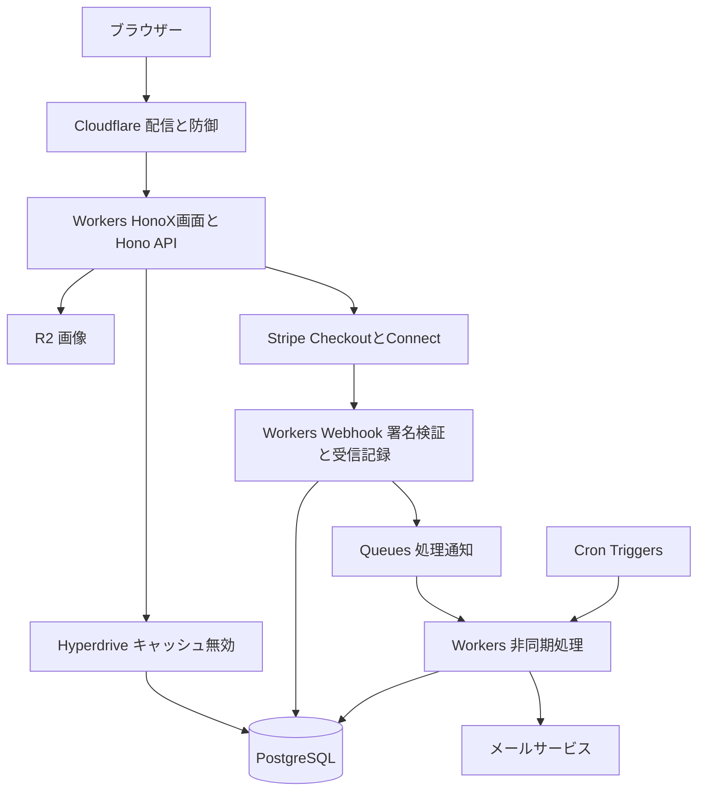

# Hono HonoX Cloudflare 実装計画

バックエンドはHono、フロントはHonoX、実行基盤はCloudflareを前提に進める。最初にWorkers上で認証・DB・画面の接続を検証し、無料申込、Stripe決済、団体運用の順に実装する。

既存の[仕様検討メモ](backend-planning.md)と[DBドラフト v0.5](schema.prisma)を引き継ぐ。変更理由と未決事項は[DB設計](db-design.md)にまとめた。コード実装やCloudflareへの配置は未着手。この計画中のDBサービス・認証ライブラリ・工数は提案であり、確定事項とは分ける。

## 採用方針と構成案

| 項目 | 方針 | 状態 |
| --- | --- | --- |
| API | HonoとTypeScript | 採用方針 |
| 画面 | HonoX。SSRを基本に、操作が必要な部分をIslands化 | 採用候補として検証 |
| アプリ実行 | Cloudflare Workers。画面とAPIを同一オリジンで提供 | Cloudflare採用、配置方式は提案 |
| DB | マネージドPostgreSQL、WorkersからHyperdriveで接続 | 提案。提供元・リージョン・復元機能を選定 |
| ORM | 既存Prismaを第一候補に、Workers対応のドライバー構成を検証 | 未確定 |
| 認証 | Googleログインとサーバー側セッション。既存Auth.js想定を再検証 | ライブラリは未確定 |
| 画像 | R2。イベント画像・アイコン用 | 提案 |
| 非同期処理 | Queues。通知と決済イベントの後続処理 | 提案 |
| 定期処理 | Cron Triggers。期限切れ決済の照合、回答削除、処理再送 | 提案 |
| セキュリティ | アプリ側の権限・入力制約・操作別制限、Cloudflare側のWAF等 | 使用機能・プランは選定 |
| メール | 外部のトランザクションメール送信サービス | 未選定 |



最初は画面・API・scheduled・queueのハンドラーを同じコードベースで管理する。業務処理は共通サービスへ置き、実行時間や負荷に応じてWorkerの分割を検討する。既存のGitHub Pages用docsはそのまま資料として管理し、アプリはWorkersへ配置する案。

## 技術選定上の確認

- HonoXはファイルベースルーティング・SSR・Islandsを備える一方、公式READMEではalpha段階。採用バージョンとlockfileを固定し、更新は検証環境で確認する。[HonoX公式](https://github.com/honojs/honox)
- HonoはWorkersを対象にした公式手順がある。HonoXのビルドも含め、Workers実行環境で最初に動かす。[Hono Workers手順](https://hono.dev/docs/getting-started/cloudflare-workers)
- HyperdriveはDB本体ではなく接続基盤。別途PostgreSQLが必要。Prismaとの連携例は公式資料を基準に、採用バージョンとトランザクションを検証する。[Hyperdrive](https://developers.cloudflare.com/hyperdrive/)・[Prisma連携](https://developers.cloudflare.com/hyperdrive/examples/connect-to-postgres/postgres-drivers-and-libraries/prisma-orm/)
- Hyperdriveのクエリキャッシュは既定で有効。初回は無効にし、定員・権限・決済の読み取りが古くならない構成にする。公開一覧のキャッシュは別途明示的に設計する。[キャッシュ仕様](https://developers.cloudflare.com/hyperdrive/concepts/query-caching/)
- PostgreSQLの行ロックと部分一意インデックスを使う既存方針を維持するため、初回はD1への移行を行わない案。KVやキャッシュを席数・決済状態の正としない。
- Queuesと定期処理は再実行を前提にする。実行回数に依存せず同じ結果に収束させる。[Queues](https://developers.cloudflare.com/queues/)・[Cron Triggers](https://developers.cloudflare.com/workers/configuration/cron-triggers/)

## 実装する単位

```text
app/
  routes/           HonoX画面とHTTP入口
  islands/          価格枠選択、フォーム、受付などの操作
  components/       デザインを組み込む表示部品
  server.ts         HonoXとHono APIの組み立て
  server/
    api/            Hono APIルート
    auth/           認証とセッション
    middleware/     権限、入力、requestId、エラー変換
    services/       申込、決済、受付などの業務処理
    repositories/   DBアクセス
    jobs/           決済照合、回答削除、通知
    integrations/   Stripe、メール、ストレージ
prisma/             実行用スキーマとSQLマイグレーション
tests/             業務処理・API・通し操作の検証
```

ディレクトリは案。ルート名は業務処理を持たず、本人確認・入力検証を経てサービスを呼ぶ。SSRからも同じサービスを呼び、画面から自分自身のAPIへ通信する必要はない。ブラウザー操作にはAPIを使う。認証済み画面・API・個人情報を共有キャッシュに保存しない。

## 実装順序と完成条件

工数は主担当1名の実作業日数の目安。デザイン作業、外部審査待ち、仕様決定待ち、追加機能は含めない。最初の接続検証後に見積もりを更新する。

| 段階 | 作業 | 完成条件 | 目安 |
| --- | --- | --- | --- |
| 0 接続検証 | HonoX＋Workers、PostgreSQL＋Prisma＋Hyperdrive、Google認証候補、ローカルと検証環境の構築 | Workers上でログイン、DB読み書き、SSRとIslandの操作、ロックを伴うトランザクションが動く | 3〜5日 |
| 1 DBと安全性の土台 | 1イベント1枚へスキーマ修正、SQL制約、セッション、団体権限、公開項目、監査、入力検証、CI | 不正な入力・他団体への操作を拒否し、DB制約が実DBに適用される | 4〜6日 |
| 2 イベントと無料申込 | 団体・owner、イベント・価格枠の登録と公開、質問、無料申込、QR、マイページ、受付 | 無料イベントを作成→本人が1枠申込→QR受付まで通る | 5〜8日 |
| 3 有料申込 | Checkout、Webhook受信記録、冪等処理、席確保、期限照合、返金反映、通知 | Sandboxで成功・中断・再送・遅延・通信失敗が収束し、定員と決済が一致 | 6〜10日 |
| 4 団体入金と運用 | Connect、利用可能状態、入金先、手数料、権限、CSVと通知運用 | 団体登録から購入・入金関連記録・返金まで検証できる | 4〜7日 |
| 5 公開準備 | デザイン統合後の通し確認、負荷・権限テスト、復元、監視、停止と復旧、本番設定 | 公開チェックを通し、承認済みの手順で本番決済を確認できる | 4〜6日 |

合計26〜42実作業日が仮の目安。画面の構造・CSS組み込みも段階2以降に含めるが、納品形式と画面数で変わる。既存予定の公開日から逆算する場合は、必須機能と稼働日を確認して再計算する。Connectの契約主体・申請確認は段階0と並行して開始する。

記事投稿・審査、フォロー、保存、お知らせ一斉配信、Walletは上記の最小販売フローの工数外。公開必須なら独立した作業と完成条件を追加する。

## DBと申込の具体的な変更

- Payment.slotIdsを単一slotIdへ変更し、購入時価格・通貨・入金先・手数料の保存方法を決める。
- RegistrationにeventIdを追加し、CONFIRMEDの(userId, eventId)を部分一意にする。slotIdとの整合性を複合外部キー等で保証する。
- PaymentのPENDINGの(userId, eventId)を部分一意にする。別タブの競合は既存手続きへの案内に変換する。
- 無料申込・有料開始・確定・期限切れは、同じ順序でEventとSlotをロックする。Stripeとの通信中はDBロックを保持しない。
- Stripe呼び出し前のPayment準備状態を表現できるようproviderRefの必須条件を再設計する。Payment IDを冪等キーに用い、通信結果不明時も照合できるようにする。
- Webhook受信記録と通知のOutboxを追加する。DB保存とキュー送信の間で失敗しても、定期処理で再送できるようにする。
- Webhookは署名検証後に必要なイベントを永続化して応答する。キュー側で処理済み判定・決済照合・申込確定を実行し、失敗は再試行する。キュー投入だけで処理済みにはしない。
- 回答と公開プロフィールを別の出力型にする。電話・メールを除外するだけの全列公開は行わない。

## 認証とセキュリティの完成条件

認証ライブラリは段階0で決める。v0.5 の User・Session モデルは選定結果に合わせて変更する。独自のOAuth・暗号方式は実装せず、Workers対応の実績と保守状況、Google認証、セッション失効、CSRF対策を確認する。

- Googleログインのリダイレクトとstate等の検証、Cookie属性、ログアウト、権限変更後の扱いを確認する。
- 管理者、owner、参加者、未ログインの操作権限を表にし、IDの差し替えでも他人の情報に触れないことを検証する。
- ログイン・申込・決済開始・CSV等を操作別に制限する。Cloudflareの制限機能はプランとカウンターの適用範囲を確認し、厳密な業務制約はDBで守る。
- 管理者保護、公開項目の許可リスト、本文のXSS対策、CSRF、アップロードの形式・サイズ制限、秘密情報管理を実装する。
- 監査ログは重要操作と結果を記録し、申込回答・メール本文・トークンを含めない。保存先と保持期限、通知先、対応者を決める。
- 新規購入の停止中もWebhookと照合処理は継続できる。検証環境には本番個人情報と本番Stripeキーを入れない。

## テストと公開手順

単体テストは価格計算、権限、状態遷移などの業務ルールを対象にする。DB制約と同時申込は実PostgreSQLで検証し、Node上だけでなくWorkersランタイムでAPI・接続を確認する。

公開前に必ず通すケース：最後の1席への同時申込、別タブ・別価格枠での重複、無料と有料の競合、Webhook重複・順序逆転、Stripe応答不明、期限切れと支払いの競合、他団体の情報へのアクセス、QR失効、通知再送、回答削除、DB復元。

CIで型検査・必要なテスト・ビルド・依存関係と秘密情報の検査を行う。マイグレーションはアプリ起動時に実行せず、専用の権限で配置前に適用する。変更は可能な限り旧版とも互換にし、アプリのロールバックだけで戻せないDB変更は別の復旧手順を持つ。

ローカル・検証・本番でDB、ストレージ、キュー、認証のリダイレクト、Stripe、秘密情報を分離する。本番の配置・課金リソース作成は、この計画の作成には含めない。

## 着手前に詰める項目

1. 具体的な収集項目と公開範囲。自由記述、参加履歴、参加者一覧も含める。
2. 販売主体と入金先、手数料、返金条件、Connectを初回公開に含めるか。
3. 懇親会の扱い、キャンセル後の再購入、席確保時間。
4. PostgreSQL提供元と認証ライブラリ。Cloudflareアカウント、ドメイン、予算、管理権限。
5. デザイン納品形式。HonoX用JSX、HTML/CSS、Figmaのどれを受け取り、誰が画面を組み込むか。React前提の部品がある場合はHonoX側のレンダラーと互換性を先に確認。
6. 初回公開の必須画面・機能、担当者の稼働、公開目標日。

未決事項を待たずに進められる最初の作業は、段階0の最小接続検証と、公開・非公開データを分けたAPI契約のたたき台。実決済の入金構成や個人情報の公開範囲は、確定するまで本実装へ固定しない。

公式資料確認日：2026年10月29日。
